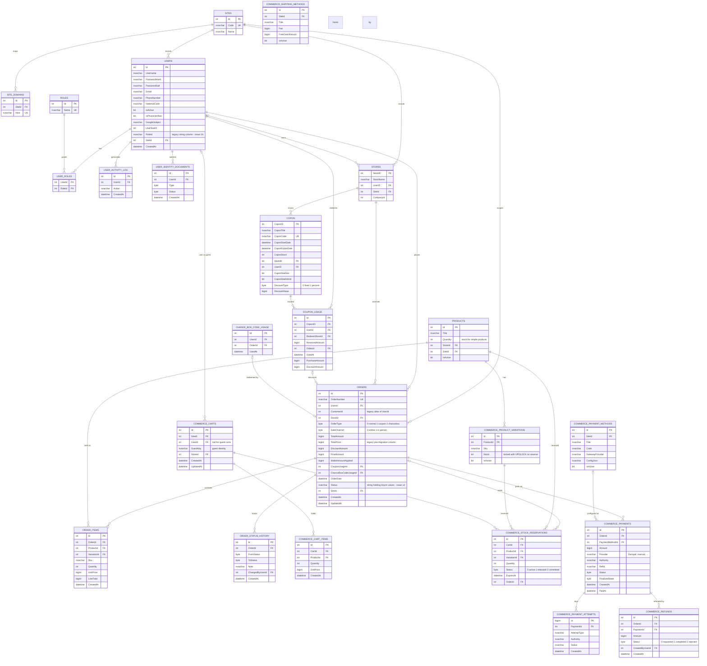

# Koochino (MyShop) — Core Database ER Diagram

> Reconstructed from the entity models (`MyShop.Core/Models`) and the SQL embedded in the
> repositories (`MyShop.Infrastructure/Repositories`). The DDL itself (tables, constraints,
> and the `koch.sp*` stored procedures) lives in the database and is not committed to this repo.
> Last reviewed: 2026-10 (main).

GitHub renders the diagram below natively.

## Entity relationship diagram — commerce & identity core

## Notable schema observations

| Observation | Impact | Issue |
|---|---|---|
| `Users.RoleId` is a legacy string column next to the real `UserRoles` table | Write-during-login role sync, duplicate-row race | [#16](https://github.com/PsymoNiko/koochino/issues/16) |
| `Orders.Status` is NVARCHAR holding tinyint values | `TRY_CAST` per row blocks index use | [#14](https://github.com/PsymoNiko/koochino/issues/14) |
| `Orders` has both `UserId` and legacy `CustomerId`, `TotalAmount` and legacy `TotalPrice` | `ISNULL()`/fallback logic in every query | [#14](https://github.com/PsymoNiko/koochino/issues/14) |
| `Users.PhoneNumber` matched with `REPLACE()/RIGHT()` in SQL | Full table scan per login | [#13](https://github.com/PsymoNiko/koochino/issues/13) |
| Every business table carries `SiteId` for multi-tenancy | Site filter currently applied post-pagination and fail-open | [#15](https://github.com/PsymoNiko/koochino/issues/15) |
| Coupon table named `Copon` with string money columns (`CoponMinBuy`) | Naming/type inconsistency | — |

## Out of scope

The Academy, CRM, Tickets, Warehouse, Blog, Points/Loyalty, Support chat, and
Module-settings domains exist in the repositories but are not expanded here.
The stored procedures (`spUsers_*`, `spOrders_*`, `spCopon_*`, ...) are not
committed to the repo and should be exported to version control (see the
accompanying performance doc).
